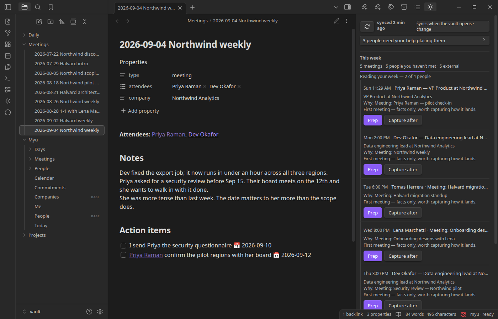
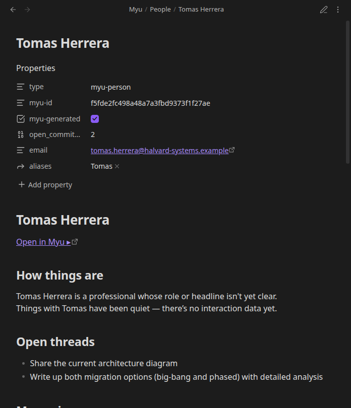
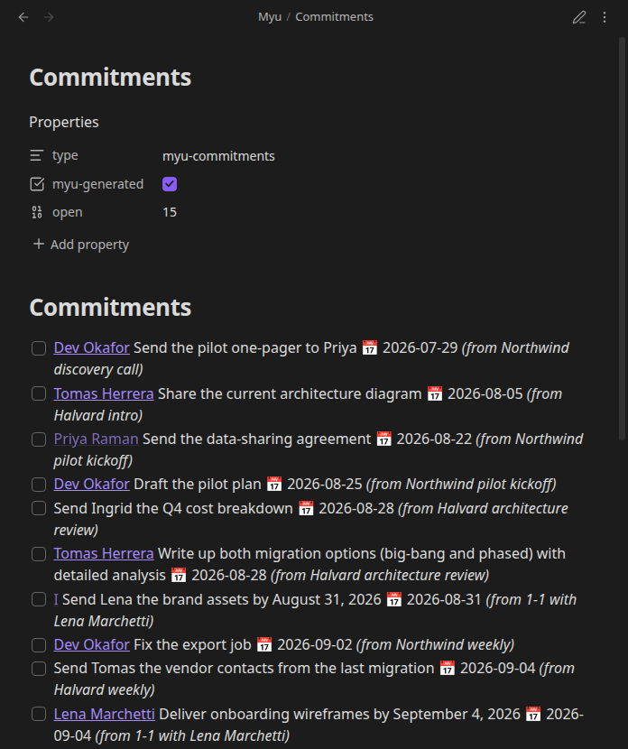
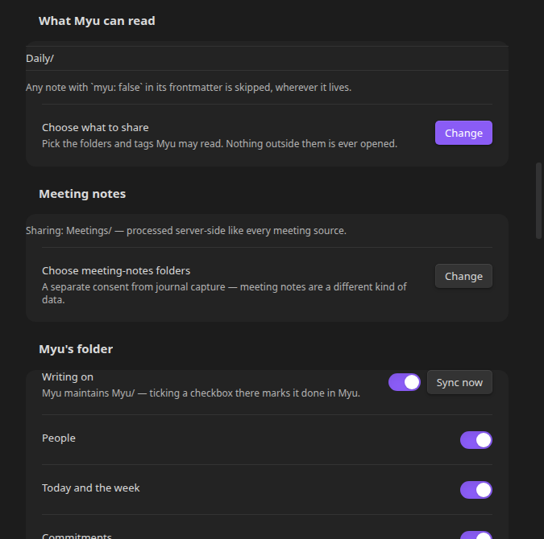

# askMyu — Obsidian plugin

This plugin connects your Obsidian vault to askMyu. It sends the notes you choose to askMyu,
encrypted before they leave your computer, and shows your day in a pane beside your notes.



## What it does

- **Today.** A pane on the right with the morning brief and the day's meetings. Each person,
  company, space and meeting is one row with the one thing Myu has to say about it. Rows that
  need you come first. It refreshes every five minutes.
- **Myu's questions, with buttons.** A yes/no question shows Yes and No. A question with set
  answers shows them. Every question also has "Not now" (it comes back tomorrow) and "Don't
  ask again".
- **What you owe.** Under Today: what you owe people and what they owe you.
- **Before a meeting.** A card for the meeting: what it is for, what happened last time, your
  moves, a block per person, and what to know before you go in. Myu's question before the
  meeting is answered on the card.
- **Chat.** Talk to Myu beside your notes: about a note, a selection, a person, a meeting. A
  long paste becomes a block beside your words. "Ask Myu about this note" sends the note.
- **Capture.** Notes in the folders you choose are encrypted on this computer and sent to
  askMyu when you stop editing them. One note stays one entry however many times you edit it.
  Notes keep their own dates, so older notes arrive as history.
- **Meeting notes (optional, asked separately).** Notes in folders you choose, or tagged
  `myu-meeting: true`, become meetings Myu understands: decisions, owners, follow-ups.
  **Unlike journal notes, meeting notes are readable by askMyu's servers.** The consent screen
  says this before anything is shared.
- **Save to vault (optional, one item at a time).** A canvas as an Obsidian `.canvas` file, or
  a conversation as a note. The plugin always asks first, and marks every file it writes with
  `myu-generated: true` so you can find them all.
- **Canvases.** Press a card on a canvas and Myu answers in the conversation. Old canvases say
  so and offer Refresh. Canvases Myu makes while you are away are offered as rows, never opened
  on you.
- **Help Myu.** People Myu cannot place, such as a LinkedIn profile to confirm, appear as rows
  in Today. One decision each.
- **Correcting a person.** From a card: fix a fact (name, role, company, email), correct or
  delete a memory, merge two people who are the same person, archive, or delete for good after
  confirming.
- **People from your mail.** People who were only on some of your emails stay out of the
  people list. "Keep track" brings one back. Search still finds them.
- **Spaces.** Every space you belong to has a row under Spaces in Today. It opens that space's
  conversation with Myu: one question at a time, with buttons when a question has set
  answers. *See the team's retro* shows the retro as a page to read. Archived spaces are not
  listed.
- **Interview debriefs.** A debrief has its own conversation with Myu and a row in Today. The
  interview time shows on the calendar beside your other events.
- **Myu's folder (optional).** A page per person, every open commitment as a checkbox that
  syncs back when you tick it, `Myu/Me.md` with your own card, `Myu/Today.md` with what needs
  you today, and a daily log at `Myu/Log/<day>.md`. The pages have properties at the top that
  Obsidian's Bases and the Dataview plugin can read.
- **What is new.** The status bar shows what came in since you last looked ("myu · 3 new in
  Today · 2 in Spaces"). On a phone, the same words sit at the top of the Today pane.
- **Snippets.** Settings → Weave Myu in gives you ready-made blocks for your daily and weekly
  notes, a Tasks query for your commitments, a people table, and a button to Today. Nothing is
  written to your vault unless you press *Keep a copy in Myu/*.
- **Connections.** Google and Microsoft accounts, Slack and Zulip, all from settings. The
  plugin also saves this computer's time zone to your account when it changes, so your
  morning brief follows your day.
- **Names in notes.** `[[Marcus Webb]]` in a note tells Myu a person is mentioned. The plugin
  passes the name along. It never decides who anyone is.
- **Feedback.** Send feedback from the plugin, with up to five files from your computer (10 MB
  each, 15 MB in all). They go to the team by email and nowhere else.

What Myu's folder looks like:





The people in the pictures are made up.

## Getting started

1. **Install the plugin** from Obsidian's community plugins, or by hand from a release.
2. **Sign in.** The plugin asks for your askMyu account. You can create one from the plugin.
3. **Give this vault the key.** Your notes are locked with a key that only your own devices
   have, so a new vault needs a copy. The connect window offers up to three ways:
   - **Your password for new devices**, if you set one in askMyu. Type it and you are in.
   - **Approve from another device.** The window shows a 4-digit code. Type it into askMyu on
     your phone or in the web app.
   - **Your recovery phrase.** The 12 words you saved when you set up encryption.

   The password and the phrase are used on this computer and not stored.
4. **Choose what to share.** Settings → What Myu can read. Nothing is shared until you choose
   a folder. Any single note can opt out with `myu: false` in its properties.
5. **Turn on Myu's folder** if you want Myu to write pages into your vault. It is off until
   you turn it on.

## Common questions

- **Can I run my own server, or use it offline?** No. There is one server, `myu.askmyu.com`,
  and it is the only place the plugin talks to. Offline, everything Myu already wrote into
  your vault still opens, because it is plain markdown and canvas files. Capture pauses and
  catches up when you are back online.
- **What exactly is sent?** Only notes in the folders you chose, encrypted on this computer
  before they leave, plus the requests listed under "Everything it sends" below. Nothing is
  tracked or measured.
- **Can I keep my journal, or any note, out of it?** Yes. Share only the folders you choose.
  Nothing is preselected. A single note opts out with `myu: false` in its properties.
- **Will it change my notes?** No. Myu writes only inside its own folder (`Myu/` by default).
  Your notes are read when shared, and linked to, never edited.
- **Can I change the folder?** Yes, in settings. Everything Myu writes lives under it.
- **How do I delete my data?** "Remove everything Myu wrote" (in settings, or as a command)
  sends every file Myu made to the trash. "Delete my account" removes everything on the
  server. "Export everything" and "Request my data archive" get you a copy first.

## What it will not do

- **No pop-ups about people.** Obsidian's notices are used for errors and status only.
- **No writing into your vault until you ask.** Everything Myu writes is behind its own
  consent screen, lands under one folder you choose, and carries `myu-generated: true`. Myu
  never writes into notes you authored.
- **No reading before you choose.** Until you pick a folder to share, the plugin does not watch
  your vault at all.

## If you uninstall

- Every file under `Myu/` stays as it is. None of it needs the plugin to open.
- Your own notes were never changed.
- The plugin's own settings file (`data.json`) goes with the plugin. It holds your sign-in
  token and a locked copy of your key. Nothing usable is left on this computer.
- Your account stays. Delete it from Settings → askMyu → Delete account, or on the web.

## Getting your data out

- **Export everything into the vault** (Settings → askMyu → Advanced, or the command): every
  page, every conversation as a note, every canvas that still exists on the server, and a
  receipt at `Myu/Export.md` saying what was written.
- **Request my data archive**: everything the server holds, as one encrypted zip. The link
  comes by email. The passphrase is shown once and never stored.

## How the encryption works, in plain words

Your notes are encrypted on this computer before they leave, with the same key your other
askMyu devices use.

That key is stored on this computer in locked form. The thing that unlocks it is kept on the
server. Neither half is useful on its own. When Obsidian starts, the plugin fetches the
server's half over your sign-in, unlocks the key in memory, and keeps it there. Nothing
unlocked is written to disk.

What this means for you:

- **A new vault gets the key one of three ways**: your password for new devices, approval from
  a device you already use, or your recovery phrase. See Getting started.
- **Starting up offline leaves the vault locked.** No network means no key. Capture pauses
  with a badge until you reconnect.
- **You can revoke a device.** Removing this device in askMyu deletes the server's half, which
  makes the locked copy on this computer useless for good.
- **Obsidian has no plugin sandbox.** Any plugin you install can read any other plugin's files,
  including this one's `data.json`. The split above limits what that file is worth on its
  own. No plugin can protect itself from another plugin that tampers with Obsidian itself.
  That is true of every plugin you install.

## What the plugin can access

- **Network**: only the askMyu server. Every request is listed below.
- **Your vault**: it reads the notes and folders you allow in Settings → What Myu can read. It
  lists the vault's file names (never their contents) to find your own person pages and the
  files Myu wrote. It writes only under the `Myu/` folder, after your consent, plus one CSS
  file in your vault's settings folder (`.obsidian/snippets/myu-look.css`) when you press
  *Install the look*. Never outside the vault.
- **Clipboard**: only when you press a copy button: your recovery phrase, or a snippet from
  Weave Myu in. The plugin reads the clipboard only to clear the phrase you just copied.
- **Account**: required. askMyu is a service, and the plugin is a way to use it.
- **Cost**: free during the beta. Creating an account means agreeing to the
  [Beta Participation Terms](https://www.askmyu.com/beta-program-participation-terms) and the
  [Privacy Policy](https://www.askmyu.com/privacy-policy). The plugin shows them with a
  checkbox, and the server records which version you agreed to.

Every permission is a row in Settings → askMyu, and every one can be changed or withdrawn
there:



## Everything it sends to the server

Obsidian asks plugin authors to say what their plugin sends over the network. This section
lists all of it. The plugin talks only to the askMyu server (`myu.askmyu.com`). No other
services, no analytics, no ad networks.

**Links that open in your browser.** A few buttons open a web page: the terms and the privacy
policy on askmyu.com, the askMyu web app, the look file on github.com, and a person's
LinkedIn profile from their card. The page opens only when you press the button. The plugin
itself never loads those sites.

**Why some of it is encoded text.** Encrypted notes and locked keys are binary data. The
plugin turns them into text (base64) to send them, and back again. That is the only encoding
it does, and the plugin's code ships readable, not minified, so anyone can check.

**No usage tracking.** The plugin does not measure, count or report how you use it, and there
is no switch to turn that on. A build check fails if any part of the plugin outside its one
network module opens a connection. askMyu's servers log requests the way any service does; the
[privacy policy](https://www.askmyu.com/privacy-policy) describes that.

In the tables, "nothing but the request" means the server learns only that you asked, and
which signed-in account asked.

### Account, keys and sign-in

| what it asks the server | when | what it sends |
|---|---|---|
| `POST /account/plugin-token/exchange` | when you connect, and every time Obsidian starts | this plugin's sign-in token |
| `POST /account/plugin-token/create` | after you sign in | nothing but the request |
| `POST /account/session/escrow-key` | every time the vault unlocks | your key, held by the server for this sign-in only, so Myu can read your content while you use it |
| `POST /account/device/kek/store` · `kek/get` | when this vault becomes a device · each unlock | the key that protects the copy of your key stored on this device (the server keeps one half, this device the other) |
| `POST /account/device/transfer-request` · `-approve` · `-deny` | approving this vault from another device | a one-time exchange key; the 4-digit code |
| `GET /account/device/transfer-pending` · `-receive` | approving this vault from another device | nothing but the request |
| `GET /account/recovery/wrapped-key` | unlocking with your recovery phrase | nothing but the request |
| `GET /account/password/wrapped-key` | connecting this vault, when your account has a password for new devices. Read once when the connect window opens. The password you type opens the copy on this device and never leaves it | nothing but the request |
| `POST /account/recovery/setup` | setting up your recovery phrase | your key, locked with the phrase. **The phrase itself never leaves this device** |
| `POST /account/create` | creating an account from the plugin, with a password | your email, name, password, and which terms you agreed to |
| `POST /auth/magic-link/request` · `GET /auth/magic-link/validate` | creating an account from the plugin, with an emailed link | your email, name, and which terms you agreed to; then the single-use code from the email |
| `GET /terms` | opening the create-account screen | nothing. It is public and says which version of the terms to show |
| `POST /account/terms/accept` | the "Before you start" screen | which terms you agreed to |
| `POST /account/background-work/set` | the settings switch for work between visits | your choice |

### What you share

| what it asks the server | when | what it sends |
|---|---|---|
| `POST /journal/add` | capturing a journal note | your note, **encrypted on this device first** |
| `POST /meetings/ingest_note` | capturing a meeting note (only if you turned that on) | the note, **readable by the server. The consent screen says so** |
| `POST /journal/add` · `POST /journal_chats/add` | chatting with Myu | your messages, and any text, note or selection you paste in, marked as pasted |

### Reading your day

| what it asks the server | when | what it sends |
|---|---|---|
| `GET /feed/brief` · `/review/weekly` · `/initiative/mirror` · `/card/self` | the Today pane, every five minutes | nothing but the request |
| `GET /card/self?level=deep_dive` | writing `Myu/Me.md`, your own card in full | nothing but the request |
| `POST /calendar/events` | the Today pane and the calendar. The answer includes Myu's own entries, such as an interview time you set by hand | the dates to show |
| `GET /prep/meeting` | opening a meeting's card | which meeting |
| `GET /feed/entities` · `/feed/entities/search` · `/card/person` · `/card/company` | looking someone up; opening a person's or a company's card | what you typed, or which person or company |
| `POST /card/board-lite` | a card's extra views | which person or company |
| `POST /card/identity/confirm` · `/v2/relationships/linkedin/suggestion/resolve` | confirming who someone is on a card | the person you picked |
| `GET /memories/relationship/{id}` | writing a person's page | which person |
| `GET /meetings/list` · `/meetings/get` | past meetings; a meeting's notes opened from its card | which meeting |
| `GET /journal/get` · `/journal_chats/get` | reading past journal entries and chats | nothing but the request. Entries are decrypted on this device |
| `GET /composition?id=` | saving a canvas into the vault | which canvas |
| `POST /initiative/pattern-feedback/submit` | the monthly summary's yes or no | your answer |
| `POST /composition/interaction` · `/composition/refresh` · `/composition/history` | pressing a card on a canvas; Refresh; the list of past canvases | which canvas, which card and which choice you pressed |
| `GET /today/bundle` | the Today pane, when the server can answer its six reads at once | the dates to show and your time zone |
| `GET /myu/lines?scope=` · `GET /myu/log` | the line under each Today row; the Help Myu rows; the day's log in Myu's folder | nothing but the request |
| `GET /myu/menu-marks` | the status bar's count of what is new ("myu · 3 new in Today · 2 in Spaces"; on a phone, the same words at the top of the Today pane). Read at sign-in, with the Today pane's refresh, and soon after one of Myu's questions changes | nothing but the request |
| `POST /myu/menu-marks/opened` | opening the Today pane, a space's conversation, the chat pane, the canvas pane, a card or a meeting's card. At most once a minute for a place with nothing new | which of those you opened, so your other devices stop calling it new |
| `POST /myu/lines/seen` | one of Myu's lines has been on screen for a second, in the Today pane, the chat pane or a meeting's card. Each line is reported once (again if it comes back after *Not now*, or after six hours). Not reported from a hidden window or a pane behind another tab | which lines you have seen, so Myu knows. An interview debrief Myu drafted sends its invitations a few minutes after you have seen it, if you turned that on |
| `GET /commitments` | Today's *what you owe* | nothing but the request |
| `POST /gattai/spaces` | the Today pane: the spaces you belong to | nothing but the request |
| `GET /myu/conversation` · `POST /myu/lines/answer` · `GET /retro/prep/mine` | a space's or a meeting's conversation: reading it, pressing a button on Myu's question, and the words on the space's row in Today | which space or meeting, and the answer you pressed. Words you type go through `POST /journal_chats/add` (above) |
| `GET /retro` | *See the team's retro* | which space |
| `GET /feed/related-persons` · `/feed/related-memories` · `/feed/entities/dispatch` · `/feed/search` · `/card/source-detail` | a card's "around them"; "what's up with X"; Search Myu; "where this came from" | which person, or the words you typed into search |
| `POST /experiments/relationships/mark-as-self` · `POST /relationships/archive` | "This is me" on a person; archiving or restoring a person | which person |
| `POST /v2/relationships/profile/update` · `POST /v2/relationships/memories/edit` | correcting a person from their card: a fact (name, role, company, email); a memory you correct or delete | which person, and the fact or correction you typed |
| `POST /v2/relationships/merge` · `POST /v2/relationships/purge` | merging two people who are the same person; deleting a person for good, after you confirm | which two people and why; which person and your confirmation |
| `GET /v2/relationships?map=only` · `POST /v2/relationships/keep` | the list of people from your mail that Myu is not keeping track of; *Keep track* on one of them | nothing but the request; which person you keep track of |
| `POST /composition/action` · `/composition/mutate` · `GET /composition/for-journal` | pressing a control on a canvas; editing a canvas; reopening a past conversation | which canvas and card, and what you pressed or changed; which conversation |
| `POST /feed/entities/dismiss` · `POST /v2/relationships/linkedin/{id}` (unlink) | dismissing a suggestion; Unlink LinkedIn | which person |
| `POST /meetings/add-decision` · `/meetings/add-commitment` · `GET/POST /meetings/drive/*` · `POST /meetings/import/drive` | a bullet you type under a meeting note's Decisions or Commitments; importing from Google Drive | that bullet's text and owner; which Drive files you chose |
| `GET /personal_loop/get` · `POST /feedback/signal` · `POST /feedback/submit` | the 👍/👎 on Today and on a reply; Send feedback | your rating; your feedback text, the plugin's build number, which conversation (for a reply), and any files you add with *Add a file* (up to 10 MB each, 15 MB in all; they go to the team by email and nowhere else). Never a screenshot. Nothing from your vault unless you add it as a file |
| `GET <origin>/sse/get` | a live connection the server pushes updates through | nothing. Updates come in |

### Myu's folder (opt-in)

| what it asks the server | when | what it sends |
|---|---|---|
| `POST /vault/commitments` | writing Myu's folder | nothing but the request |
| `POST /vault/interaction` | ticking a checkbox Myu wrote | which checkbox. Never your own notes |
| `GET /vault/changes` | refreshing Myu's folder: what changed, so only those files are rewritten | when the last refresh was |

### Telling Myu who you are, and connecting sources (all opt-in)

| what it asks the server | when | what it sends |
|---|---|---|
| `GET /account/state/check` · `POST /account/state/update` | the first-run questions | your answers |
| `GET /linkedin/seek` · `POST /account/career/update` | the LinkedIn address you paste at first run. If the profile is in another name than your account's, the plugin asks whether it is yours first | the LinkedIn address, and your answer when it asked |
| `GET /onboard/current_employment` · `POST /onboard/current_employment_confirm` | confirming your current job at first run | your confirmation |
| `POST /resume/upload` | adding a resume at first run (optional) | the file you chose |
| `POST /onboard/classify_career_moment` | the first-run question about where you are in your career | what you wrote |
| `POST /oauth/google/init` · `/oauth/microsoft/init` | connecting Google or Microsoft (calendar, mail and meeting notes each on their own) | nothing. You give consent in your browser |
| `GET /oauth/google/status` · `/oauth/microsoft/status` · `/slack/connections` · `/zulip/connections` | the settings page, to show what is connected | nothing but the request |
| `POST /oauth/{google,microsoft}/disconnect` · `/oauth/{google,microsoft}/credential/set-primary` · `/slack/connect` · `/slack/disconnect` · `/zulip/connect` · `/zulip/disconnect` | the settings buttons for those connections | which account; for Zulip, the server address, email and key you typed (sent once, kept on the server) |
| `POST /account/update` · `GET /account/career` | Settings → Account | your name; otherwise nothing but the request |
| `GET /account/devices` · `POST /account/device/remove` · `/account/device/rename` | Settings → Account → your devices | which device; its new name |
| `GET /account/emails/list` · `POST /account/emails/add` · `/resend` · `/remove` · `/set-primary` | Settings → Account → your email addresses | the address you typed or chose |
| `GET /account/preferences/get` · `POST /account/preferences/update` | Settings → Account → preferences; also at sign-in and when the vault opens | the preferences you changed; this computer's time zone when it differs from the saved one, so your morning brief follows your day |
| `POST /account/data/export-request` | Settings → Download your data | nothing but the request. The link comes by email |
| `POST /account/delete` | Settings → Delete account, after you type the confirmation | the confirmation you typed |
| `GET/POST /email/generic/*` | connecting a mail account by IMAP (optional) | the mail server details and password you typed |
| `GET/POST /calendar/caldav/*` | connecting a calendar by CalDAV (optional) | the calendar server details and password you typed |
| `POST /calendar/ical/add` · `POST /calendar/ics/upload` | adding a calendar by link or file (optional) | the private calendar link you pasted, or the .ics file you chose |
| `GET /features` | at sign-in | nothing but the request. The answer says which features the server has on |
| `POST /composition/career-trajectory` | after you confirm what Myu read from your LinkedIn | nothing but the request. It asks for the career canvas |

The plugin also registers seven `obsidian://` links (`myu`, `myu-prep`, `myu-card`,
`myu-chat`, `myu-canvas`, `myu-signin`, `myu-connected`), so that askMyu's emails, its web
sign-in page and the notes Myu writes can open the right pane in Obsidian. Email programs
strip links of that kind, so emails point at a page on the askMyu server that opens the link
for you. Those links carry only the id or name of the meeting, canvas or person to open. The
sign-in link carries a one-time code that stops working after five minutes.

## For developers

```
pnpm install
pnpm --filter @askmyu/obsidian dev          # esbuild watch → main.js
pnpm --filter @askmyu/obsidian type-check
pnpm --filter @askmyu/obsidian lint
pnpm --filter @askmyu/obsidian test         # behavioural tests
pnpm --filter @askmyu/obsidian verify       # structural checks
pnpm --filter @askmyu/obsidian build        # production bundle
```

`pnpm verify` enforces the structural rules, including the two that keep this plugin
listable: all network traffic goes through `src/transport/` (so client-side telemetry cannot be
added by accident; Obsidian's developer policies forbid it), and no module assigns HTML as a
string.

Turn on **Settings → askMyu → Use mock backend** to run the whole unlock path against an
in-memory stand-in, including its failure modes.

To test in a real vault, symlink the package into it:

```
ln -s "$PWD" "$VAULT/.obsidian/plugins/askmyu"
```

then enable askMyu in Community plugins (Restricted Mode off).

## Styling Myu

Everything Myu renders carries a stable `myu-*` class: `.myu-voice` (Myu's words),
`.myu-whisper` (quiet labels), `.myu-chat-block`, `.myu-canvas-component`, `.myu-affordance`
(buttons). You can restyle Myu's panes with an ordinary CSS snippet, the same way you style any
plugin. The plugin itself never overrides your theme.

One look ships with the plugin: [`snippets/myu-look.css`](snippets/myu-look.css), with the web
app's accents and a serif voice. **Settings → askMyu → Advanced → Myu look → Install the look**
writes it into your vault's config folder (`.obsidian/snippets/myu-look.css`) and turns it on.
The same row turns it off, updates it after a plugin update, or removes it. Nothing is fetched:
the look for the build you are running is the look it installs. The file is yours after that.
Edit it (the row will not overwrite an edited copy without asking), or take the raw file from
`https://github.com/AskMyu/askmyu-obsidian-plugin/raw/main/snippets/myu-look.css` and manage it
by hand.
